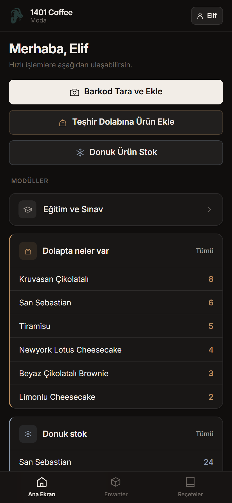
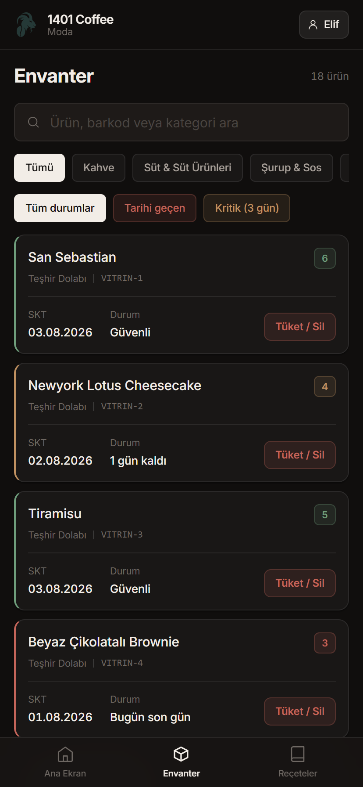
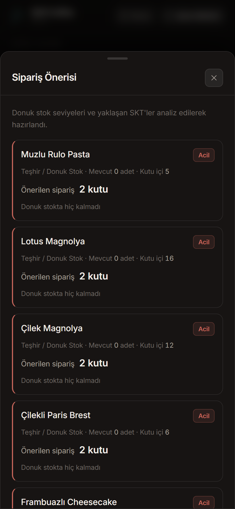
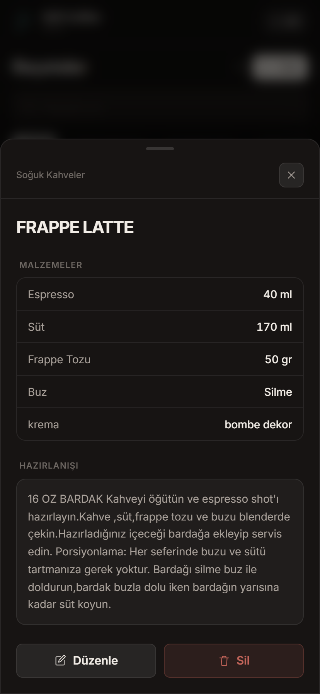
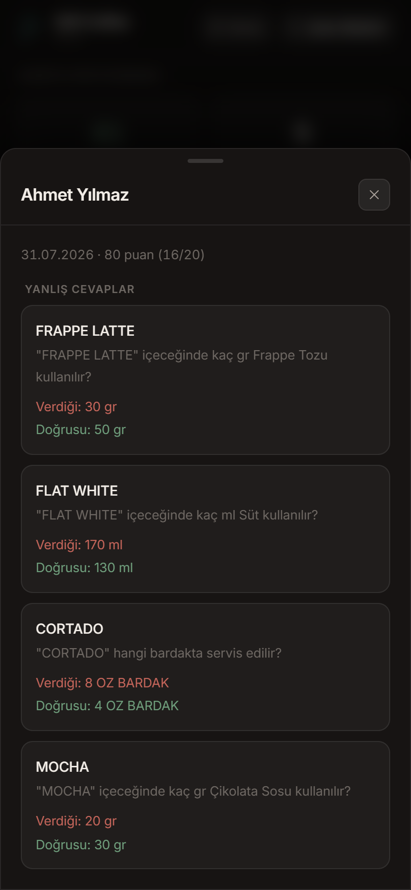
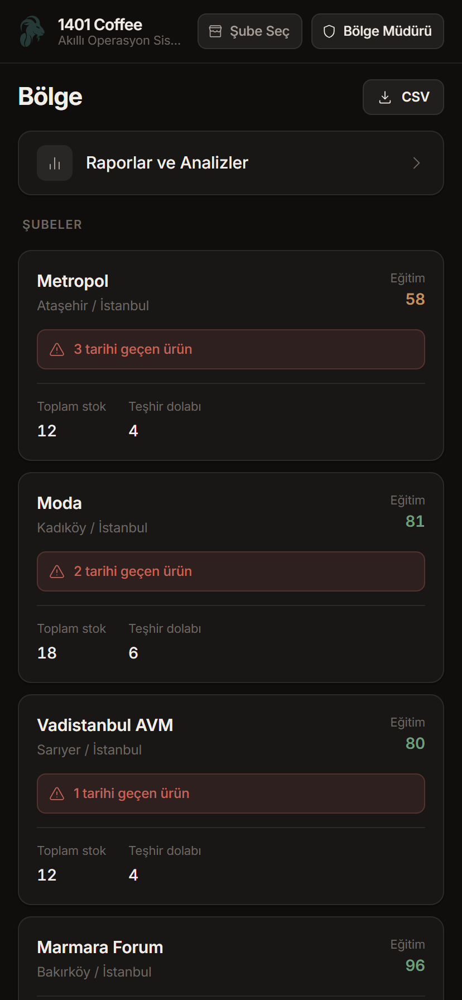

# ☕ 1401 Coffee AOS — Akıllı Operasyon Sistemi

**1401 Coffee AOS**, kahve dükkanı zincirleri için geliştirilmiş; envanter, SKT (son kullanma tarihi) takibi, donuk ürün stoğu, teşhir dolabı, reçete kitabı, barista eğitimi ve çok şubeli/çok bölgeli raporlama işlevlerini tek bir mobil uygulamada birleştiren, gerçek zamanlı bir operasyon yönetim sistemidir.

Uygulama; Android üzerinde native bir uygulama (Capacitor) olarak çalışır, verilerini Firebase (Authentication + Realtime Database) üzerinde tutar ve offline-first bir senkronizasyon motoruna sahiptir — internet olmasa bile şubede işlem yapılabilir, bağlantı geri geldiğinde veriler otomatik senkronize olur.

---

## 🎯 Bu Uygulama Neyi Çözüyor?

Bir kahve zincirinde her gün tekrar eden operasyonel sorunlar:

- "Bu ürünün SKT'si ne zaman doluyor, kim kontrol edecek?"
- "Dolapta/depoda ne kadar donuk ürün kaldı, ne zaman sipariş vermeliyim?"
- "Teşhir dolabına konacak ürün donuk stokta var mı, yok mu?"
- "Yeni işe başlayan barista reçeteleri doğru biliyor mu?"
- "Şubeler arasında hangi şube risk altında, bölge müdürü nasıl tek ekrandan görecek?"

1401 Coffee AOS, bu soruların hepsine **rol bazlı, gerçek zamanlı ve mobil-öncelikli** bir cevap verir.

---

## 👥 Roller ve Yetkiler

Uygulama üç farklı role tamamen izole ekranlar ve yetkiler sunar. Bir cihazda önce yönetici (Şube/Bölge Müdürü) e-posta ile bir kez giriş yapar; sonrasında cihaz o şubeye/bölgeye bağlanır ve gün içinde baristalar kendi PIN'leriyle hızlıca profil değiştirebilir.

| Yetki | 🧑‍🍳 Barista | 👔 Şube Müdürü | 🌍 Bölge Müdürü |
|---|:---:|:---:|:---:|
| Envanter görüntüleme | ✅ | ✅ | ✅ (salt okunur) |
| Envanter ekleme/silme | ✅ | ✅ | ❌ |
| Barkod tarama | ✅ | ✅ | ❌ |
| Donuk ürün stok yönetimi | ✅ | ✅ | ❌ |
| Reçete görüntüleme/düzenleme | ✅ | ❌ | ❌ |
| Eğitim & sınav modülü | ✅ | ❌ | ❌ |
| Raporlar ve analizler | ❌ | ✅ | ✅ (bölge geneli) |
| Şube/bölge yönetimi | ❌ | ❌ | ✅ |

Rol matrisi merkezi bir dosyada (`src/constants/roles.ts`) tanımlıdır — yeni bir yetki eklemek veya bir rolün erişimini değiştirmek tek noktadan yönetilir.

---

## 📱 Uygulamadan Görüntüler

| Barista ana ekranı | Envanter & SKT | Akıllı sipariş önerisi |
|---|---|---|
|  |  |  |

| Reçete detayı | Barista yanlış cevapları | Bölge Müdürü paneli |
|---|---|---|
|  |  |  |

21 ekranın tamamı ve ne gösterdikleri için: [`screenshots/`](screenshots/README.md)

> Görsellerdeki ürün adetleri, zayi kayıtları ve sınav sonuçları tanıtım amaçlı
> örnek verilerdir; hiçbiri veritabanına yazılmamıştır.

---

## ✨ Öne Çıkan Özellikler

### 📦 Envanter & SKT Takibi
- Native ML Kit ile kamera üzerinden barkod tarama (EAN-13, EAN-8, Code128, Code39, UPC, QR)
- Bilinmeyen bir barkod okutulduğunda **openfoodfacts.org** ve **upcitemdb.com**'dan otomatik ürün adı sorgulama
- SKT durumuna göre otomatik sınıflandırma: 🔴 Tarihi Geçen / 🟡 Kritik / 🟢 Güvenli
- Dashboard'daki durum kartlarına tıklayarak ilgili filtreyle envanter listesine geçiş
- CSV dışa/içe aktarma

### ❄️ Donuk Ürün Stoğu & 🎂 Teşhir Dolabı
- Ayrı bir "Donuk Ürün Stoğu" ekranı — ne kadar stok var, tek bakışta görülür
- Kutu içi standart adetlere göre otomatik miktar önerisi (örn. "Muzlu Rulo Pasta → 5 adet")
- Katalogdan seçim **veya** manuel ürün girişi
- **Akıllı düşüm mantığı:** bir ürün donuk stoktan teşhir dolabına alındığında, stok otomatik azalır ve işlem loglanır — teşhire eklenecek ürün listesi doğrudan donuk stoktan gelir, elde olmayan bir ürünü teşhire eklemek mümkün değildir
- Teşhir ürünleri için otomatik +3 gün SKT ataması

### 📖 Reçete Kitabı
- Kategoriye göre filtrelenebilir, isme göre aranabilir reçete listesi (76 gerçek ürün reçetesi ile birlikte gelir)
- Malzeme/gramaj bazlı ekleme, düzenleme ve silme
- Barista eğitim modülünün soru bankası doğrudan bu reçetelerden üretilir

### 🎓 Barista Eğitimi & Sınav Modülü
- Mevcut reçetelerden otomatik 20 soruluk quiz üretimi (malzeme/gramaj tahmini)
- Sonuçlar Firebase'e kalıcı olarak kaydedilir
- **Yanlış cevap detayı:** Şube müdürü, bir baristanın sınav sonucuna tıklayarak hangi soruları neden yanlış yaptığını (verdiği cevap / doğru cevap) görebilir

### 📊 Raporlar & Akıllı Sipariş
- Zayi ve tüketim dökümü, günlük analiz
- **"Ne Sipariş Vermeliyim?"** — son 30 günlük tüketim kayıtlarından günlük ortalama tüketim hızını hesaplayıp 14 günlük hedef stok miktarı öneren iki katmanlı akıllı sipariş sistemi
- Bölge Müdürü için tüm şubeleri tek ekranda karşılaştıran, tarihi geçen ürün sayısına göre sıralı bölge paneli + agregatif CSV export

### 🔐 Kimlik Doğrulama
- Şube/Bölge Müdürü: Firebase e-posta/şifre girişi (modal üzerinden)
- Barista: PIN ile hızlı profil değişimi (cihaz düzeyinde tek yönetici oturumu üzerine kurulu)
- İlk girişte zorunlu şifre değiştirme akışı

---

## 🏗️ Mimari

```
Vite + TypeScript + React 18
        │
        ├── Tailwind CSS v4 (tüm arayüz — @theme ile tanımlı özel renk token'ları)
        ├── Zustand (state yönetimi — auth / inventory / app / sync / branches / UI store'ları)
        ├── React Router (HashRouter, rol bazlı route izolasyonu)
        ├── Firebase Authentication + Realtime Database
        ├── localforage (offline yazma kuyruğu — bağlantı yoksa işlemler kuyruklanır, geri gelince senkronize edilir)
        └── Capacitor (Android native shell)
                ├── @capacitor-mlkit/barcode-scanning — native barkod tarama + el feneri
                ├── @capacitor/filesystem + @capacitor/share — CSV dışa aktarma
                └── @capacitor/app — native geri tuşu yönetimi
```

**Çok şubeli veri modeli:** Her şubenin verisi Firebase'de izole tutulur (`branches/{branchId}/...`), rol bazlı erişim Firebase güvenlik kurallarıyla (`database.rules.json`) sunucu tarafında da uygulanır — sadece istemci tarafı kontrolüyle sınırlı değildir.

### Proje Yapısı

```
src/
├── api/            Firebase init, auth, offline-sync motoru
├── components/     Paylaşılan bileşenler (Header, BottomNav, modallar)
├── constants/      Sabit veriler (kategoriler, kutu içi adetler, rol matrisi)
├── features/       Ekranlar (envanter, tarifler, tarama, raporlar, eğitim, donuk stok)
├── hooks/          İş mantığı kancaları (useInventoryManager, useSyncData, ...)
├── layouts/         Rol bazlı sayfa düzenleri ve dashboard'lar
├── store/          Zustand store'ları
├── types/          Paylaşılan TypeScript tipleri
└── utils/          Yardımcı fonksiyonlar (SKT hesaplama, barkod arama, ürün eşleme)
```

---

## 🚀 Geliştirme Ortamı Kurulumu

```bash
npm install
```

### Web'de geliştirme (hızlı iterasyon)

```bash
npm run dev
```

Barkod tarama, el feneri gibi native özellikler web modunda çalışmaz (test barkodu üretme uyarısı çıkar); arayüz/iş mantığı testleri için yeterlidir.

### Android'de çalıştırma

```bash
npm run build
npx cap sync android
npx cap run android
```

USB hata ayıklaması açık bir cihaz veya çalışan bir emülatör gerektirir.

### Firebase Kurulumu

- `src/api/firebase.ts` içinde proje config'i tanımlıdır
- Güvenlik kuralları `database.rules.json` dosyasındadır, `firebase deploy --only database` ile yayınlanır
- Kullanıcı/şube provisioning için `seed-users.js`, reçete verisi yüklemek için `seed-recipes.js` betikleri mevcuttur (ikisi de `serviceAccountKey.json` — repo'ya dahil değildir, `.gitignore`'da — gerektirir)

---

## 🗺️ Yol Haritası / Bilinen Açık Maddeler

- Sentry hata izleme entegrasyonu kurulu ama gerçek bir DSN ile aktive edilmedi
